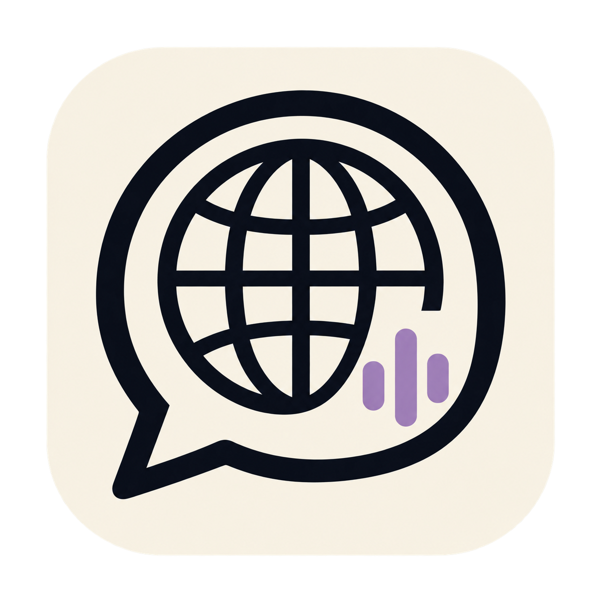

# elite-comms

A macOS assistant for Model UN delegates in any country and committee. A floating side panel transcribes the debate on your Mac, identifies speakers, and helps you answer using your own Codex account.

<p align="center"></p>

## Download

Get the DMG from [GitHub Releases](https://github.com/zabrodsk/elite-comms/releases/latest). Drag the app into Applications and open it. The app appears in the menu bar and opens its side panel.

The v0.2.0 download is signed with a Developer ID Application certificate. **It is not Apple-notarized.** macOS may block the downloaded app. If it does, use the Open Anyway option in System Settings > Privacy & Security after trying to open it.

Requires an **Apple silicon Mac running macOS 26 or later**. “Any country and committee” refers to your MUN assignment. The current binary is arm64, and transcription is English only.

## Set up your delegation

1. Install the [Codex CLI](https://github.com/openai/codex) and run `codex login` with your own account. The app looks for `codex` in standard Homebrew, local, npm-global and Bun bin folders.
2. Open the gear tab. Enter your country, committee and current topic. All three are editable text fields. Your delegate name is optional.
3. Add your position paper, study guides and country research as PDF, Markdown or text files. No country brief is bundled. When changing assignments, replace old background files through **Open folder**, click **Reload**, and start a **New session** in Notes.
4. Click **Listen** and allow microphone access. On first use, speech and speaker models download, so set it up before your meeting.

Country mentions and questions follow your chosen delegation, including known spoken aliases such as “UK” or “South Korea”. Speaker identification uses voice fingerprints and chair announcements. Click a speaker label to correct a mistake. Voice identification is approximate, especially in a noisy room.

## Use it during debate

Answers show short bullet points first, followed by simple full sentences to read aloud. Your own speech is suppressed when the app identifies your voice, self-reference, or the draft you are reading.

| Action | Shortcut |
| --- | --- |
| Show or hide the panel | Command + backslash |
| Start or stop listening | Shift + Command + backslash |
| Help me answer from any app | Option + Command + Return |
| Answer, fact-check, hit back, speech | Option + Command + 1, 2, 3, 4 |
| Help me answer from the empty input box | Return |

Click a transcript line to use it for the next action. Notes summarizes positions and proposals when you click Refresh. You can open several chat tabs. Each chat receives the selected delegation, imported brief and recent transcript. Changing the assignment or reloading background files refreshes the AI context on the next message.

## AI and data

Microphone audio is transcribed locally with Apple's SpeechAnalyzer. FluidAudio computes speaker embeddings locally. First use downloads models; AI replies require an internet connection and an authenticated Codex CLI.

AI requests send your country, committee, topic, imported brief text and relevant transcript to Codex. Fact-checks can search the web. No API key or shared account is bundled. Model access and usage limits depend on your account.

The default model is `gpt-6.1-sol`. Change it in settings to a model your account supports. The faster drafts option uses `gpt-6-luna` and requires access to that model.

Briefs and transcripts are stored in `~/Library/Application Support/elite-comms/Brief` and `Sessions`. A local source checkout with a `Brief` folder uses that checkout instead. Personal briefs, transcripts, test audio and credentials are excluded from this repository and the DMG.

## Build from source

Requires Xcode command line tools with Swift 6.2 or later and the macOS 26 SDK.

```sh
./build.sh
open ~/Applications/elite-comms.app
swift test --scratch-path "$HOME/Library/Caches/elite-comms-build"
```

The build selects a Developer ID certificate when available, then an Apple Development certificate, or an ad-hoc signature for local use. Set `ELITE_SIGN_IDENTITY` to select a certificate. Set `ELITE_INSTALL=0` to build without replacing your installed app.

## Make a release

A release requires a Developer ID Application certificate with its private key in your Keychain.

```sh
# Signed and notarized. Credentials must already be saved in Keychain.
ELITE_NOTARY_PROFILE=your-profile ./scripts/release.sh

# Signed only. Release notes must state that notarization is pending.
./scripts/release.sh --signed-only
```

The release script builds the app, includes dependency resources and font licenses, creates a compressed DMG with an Applications shortcut, signs it, verifies it and writes a SHA-256 checksum to `dist/`. The default path notarizes and staples both the app and the DMG. Release artifacts are excluded from Git and uploaded as GitHub release assets.

## Dependencies

- [FluidAudio](https://github.com/FluidInference/FluidAudio), pinned at 0.17.7, for local speaker embeddings.
- Figtree and EB Garamond fonts under the SIL Open Font License.
- License copies are in [Resources/Licenses](Resources/Licenses) and the app bundle.
